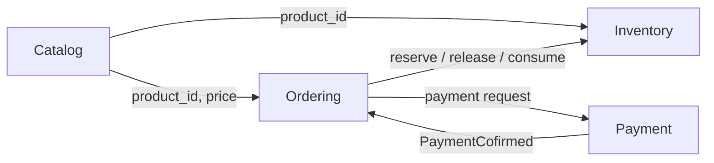
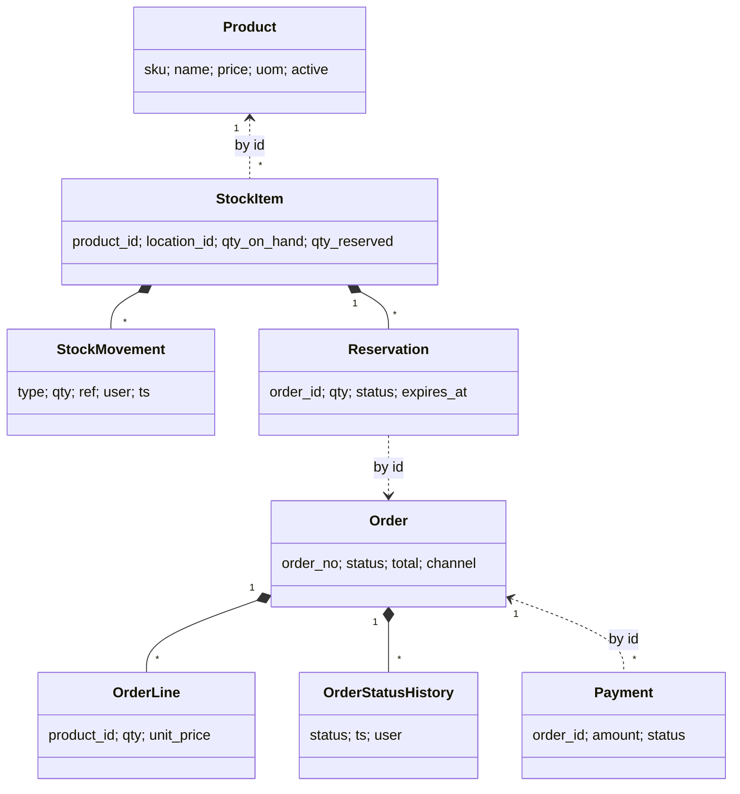

# Domain Model: CornerMart POS

- Version: 0.1
- Date: 2026-11-17

## 1. Event storming (big picture)
| Actor | Command | Domain event (past tense) | Policy (when event, then command) |
| ----- | ------- | ------------------------- | --------------------------------- |
| Admin | Create product | ProductCreated | |
| Stock manager | Receive stock | StockReceived | |
| Stock manager | Adjust stock | StockAdjusted | |
| Stock manager | Submit cycle count | CycleCounted | On CycleCounted -> adjust variance |
| Customer | Place order | OrderPlaced | On OrderPlaced -> reserve stock |
| System | Reserver stock | StockReserved / ReservationRejected | On ReservationRejected -> reject order |
| Customer / Cashier | Pay | PaymentConfirmed | On PaymentConfirmed -> mark order Paid |
| Customer | Cancel order | OrderCancelled | On OrderCancelled -> release reservation |
| System (timer) | Expire reservation | ReservationExpired | On ReservationExpired -> cancel order |
| Stock manager | Pack order | OrderPacked | |
| Stock manager | Mark ready | OrderReady | |
| Cashier | Hand over | OrderCompleted | On OrderCompleted -> consume reservation, SALE movement |
| Cashier | Checkout in-store | SaleCompleted | On SaleCompleted -> SALE movement |
| System | Check level | LowStockDetected | On LowStockDetected -> alert stock manager |

## 2. Bounded contexts
| Context | Responsibility | Owns (aggregates) |
| ------- | -------------- | ----------------- |
| Catalog | Products, barcodes, prices, UoM | Product |
| Inventory | Ledger, stock levels, reservations, counts | StockItem, CycleCount |
| Ordering | Orders, lines, status lifecycle, history | Order |
| Payment | Payment records, refunds | Payment |
| Identity | Users, roles | AppUser (APEX auth) |

## 3. Context map

Integration v1: same database, calls via PL/SQL package APIs only (no cross-context table writes). Each context = one PL/SQL package.

## 4. Aggregates
### Product (Catalog)
- Root: Product
- Parts: Barcode[] (entity), Price (value object), UoM (value object)
- Invariants: SKU unique; price >= 0; inactive product not orderable
- Commands: CreateProduct, ChangePrice, Deactivate
- Events: ProductCreated, PriceChanged

### StockItem (Inventory)
- Root: StockItem (product + location)
- Parts: StockMovement[] (insert-only), Reservation[]
- Invariants: on_hand = SUM(movements); available = on_hand - reserved >= 0; movements never updated or deleted
- Commands: Receive, Adjust, Reserve, Release, Consume
- Events: StockReceived, StockAdjusted, StockReserved, StockReleased, StockConsumed
- Concurrency: lock StockItem row (`FOR UPDATE`) in Reserve

### CycleCount (Inventory)
- Root: CycleCount
- Parts: CountLine[] (counted vs system qty)
- Invariants: closed count immutable; variance -> Adjustment movement
- Events: CycleCounted

### Order (Ordering)
- Root: Order
- Parts: OrderLine[] (product_id, qty, unit_price snapshot), StatusHistory[] (append-only)
- Invariants: >= 1 line; qty 1..99; price fixec at placement; transitions only per SRS #7; total = SUM(lines)
- Commands: Place, Pay, Cancel, Pack, MarkReady, Handover
- Events: OrderPlaced, OrderPaid, OrderCancelled, OrderPacked, OrderReady, OrderCompleted

### Payment (Payment)
- Root: Payment
- Invariants: amount > 0; refund <= paid amount; idempotency key unique
- Events: PaymentConfirmed, RefundIssued

Rules: aggregates reference each other by ID only. One transaction = one aggregate where possible. Order <--> Inventory is the exception in v1 (same DB, one transaction, since G1 needs atomic reserve).

## 5. Domain diagram

## 6. Open questions
- In-store Sale and online Order: one `sales_order` with `channel` columns? (needs ADR-0003)
- Reservation for in-store sales: none (instant deduct)?
- Is Payment a separate context or part of Ordering in v1?
