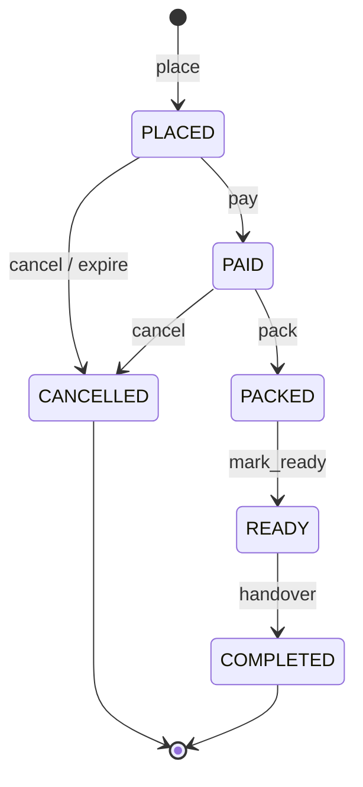
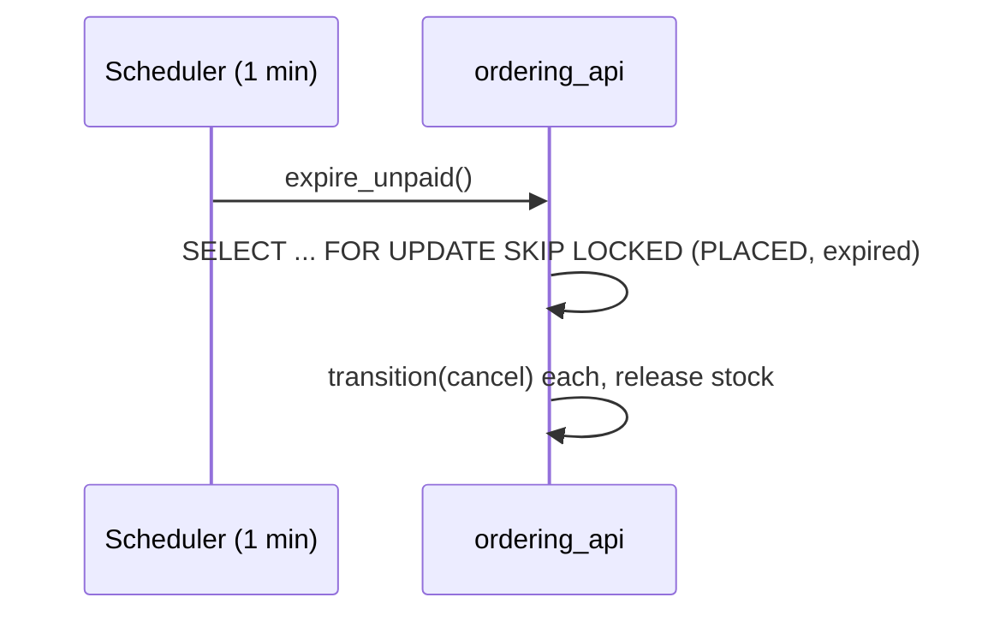

# Order & Tracking Spec: CornerMart POS

- Version: 0.1
- Date: 2026-11-17
- Refs: SRS FR-ORD/STS/TRK, #7; Domain #4 Order; Inventory #3

## 1. State machine


Terminal: CANCELLED, COMPLETED. No backward moves.

## 2. Transition table
| From | Command | To | Guard | Side effects | Actor |
| ---- | ------- | -- | ----- | ------------ | ----- |
| (new) | place | PLACED | all lines reserved | reservations ACTIVE; history row; event OrderPlaced | Customer |
| PLACED | pay | PAID | payment CONFIRMED, amount = total | extend nothing; event OrderPaid | System/Cashier |
| PLACED | cancel | CANCELLED | owner or staff | release reservations | Customer |
| PLACED | expire | CANCELLED | now > expires_at, unpaid | release reservations | Scheduler |
| PAID | cancel | CANCELLED | not packed | release reservations; refund requested | Staff |
| PAID | pack | PACKED | all lines available (reserved) | none | Stock manager |
| PACKED | mark_ready | READY | none | event OrderReady (notify customer) | Stock manager |
| READY | handover | COMPLETED | customer verified (order_no + code) | consume reservations; SALE movements | Cashier |

Implementation: one PL/SQL procedure `ordering_api.transaction(order_id, command, user)`. Only early point; UI/REST never update `status` directly.

## 3. Sequence diagrams
```mermaid
sequenceDiagram
	participant C as Customer (APEX)
	participant O as ordering_api
	participant I as inventory_api
	participant DB as DB
	C->>O: place_order(lines, idem_key)
	O->>DB: check idem_key
	loop lines sorted by product_id
		O->>I: reserve(product, qty, order)
		I->>DB: SELECT FOR UPDATE stock_level
		I->>DB: insert reservation, reserved += qty
	end
	O->>DB: insert order, lines (price snapshot), history PLACED, outbox
	O-->>C: order_no
	Note over O,DB: single transaction; any failure = full rollback
```


Handover: ordering_api.transition -> inventory_api.consume -> SALE movement -> history COMPLETED, one transaction.

## 4. Status history
- Table `order_status_history`: id, order_id, from_status, to_status, reason, changed_by, changed_at (TIMESTAMP WITH TIME ZONE).
- Insert-only (same enforcement as ledger).
- Written in same transaction as `sales_order.status` update.
- `sale_order.status` = current-state projection; history = source of truth.

## 5. Idempotency
- `place_order` takes client-generated `idem_key` (UUID); unique (customer, idem_key). Duplicate -> return original order_no, no new reservation.
- `pay`: unique `payment.idem_key`; gateway callback replay -> no-op.
- `transition`: if order already in target state -> return success (no-op); if invalid -> error.
- Keys retained 24 h minimum.

## 6. Events / outbox
- Table `outbox_event`: id, aggregate_id, type, payload (JSON), created_at, processed_at.
- Inserted in same transaction as state change.
- Job (every 10 s) processes unprocessed rows: send email (FR-TRK-02), then mark processed. At-least-once; consumers idempotent.
- Events: OrderPlaced, OrderPaid, OrderCancelled, OrderReady, OrderCompleted, LowStockDetected.

## 7. Concurrency
| Race | Handling |
| ---- | -------- |
| Two orders, last unit | `FOR UPDATE` on stock_level; second sees available 0 -> rejected |
| Pay vs expire | Both lock order row (`FOR UPDTE`); first wins; second sees new state -> no-op/error |
| Cancel vs pack | Same; guard checks current status after lock |
| Deadlock multi-line orders | Lock in product_id order; ORA-00060 -> retry once |
| Double-click submit | Idempotency key |
| Two schedulers | SKIP LOCKED |

Lock order always: order row -> stock_level rows (by product_id).

## 8. Tracking access
- Lookup: order_no + email (or phone). Public APEX page, no login.
- Rate limit: 10 attempts / 15 min / IP; generic "not found" message (no enumeration).
- Exposes: status, history (status + time), lines, total. Hides: internal IDs, staff names, costs.
- Refresh: APEX Dynamic Action polling 5 s (NFR-03); upgrade to push later if needed.
- order_no: non-sequential (e.g. CM-7K3F9Q) to prevent guessing.
- Handover code: 6 digit, shown to customer, verified at READY -> COMPLETED.

## 9. Error catalog
| Code | Condition | Message |
| ---- | --------- | ------- |
| ORD-001 | Insufficient stock | "Not enough stock for <product>" |
| ORD-002 | Invalid transition | "Cannot move from <A> to <B>" |
| ORD-003 | Order not found / no access | "Order not found" |
| ORD-004 | Duplicate request | (returns original, no error) |
| ORD-005 | Reservation expired | "Order expired" |
| ORD-006 | Lock timeout | "Busy, retry" |

## 10. Open questions
- Payment online gateway or pay at pickup? (if pay-at-pickup: PLACED -> PAID happens at handover, expiry rule changes)
- Delivery status (OUT_FOR_DELIVERY) in v1?
- Partial cancel of lines?
