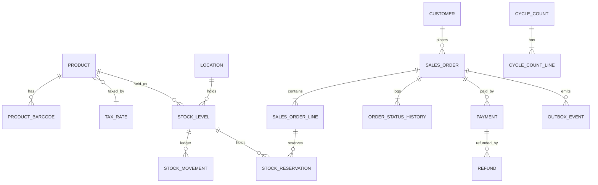

# Data Design: CornerMart POS

- Version: 0.1
- Date: 2026-11-17
- Refs: Domain #4, Inventory #1, Order #4, Financial #1

## 1. Conventions
- Tables: singular snake_case, glossary code names (`product`, `stock_movement` etc.).
- PK: `id NUMBER GENERATED ALWAYS AS IDENTITY`. FK: `<table>_id`.
- Money `NUMBER(12, 2)`, price/cost `NUMBER(12, 4)`, qty `NUMBER(12, 3)`, timestamp `TIMESTAMP WITH TIME ZONE` (UTC).
- Status/type columns: `VARCHAR2` + CHECK constraint.
- Audit columns on mutable tables: `created_at, created_by, udpated_at, udpated_by, row_version NUMBER`. Set by trigger/TAPI.
- Soft delete: `active CHAR(1) CHECK IN ('Y', 'N')`; no physical deletes on business data.
- Booleans: `CHAR(1)` Y/N
- Constraints named: `pk_`, `fk_`, `uk_`, `ck_`; indexes `ix_`.
- Public identifiers (`order_no`) separate from PK.

## 2. ERD

## 3. Data dictionary
### product
| Column | Type | Null | Key | Description |
|---|---|---|---|---|
| id | NUMBER | N | PK | |
| sku | VARCHAR2(40) | N | UK | Business code |
| name | VARCHAR2(200) | N | | |
| uom | VARCHAR2(10) | N | | each/kg/l |
| price | NUMBER(12,4) | N | | Tax-inclusive, ≥ 0 |
| tax_rate_id | NUMBER | N | FK | |
| reorder_point | NUMBER(12,3) | Y | | Manual v1 |
| active | CHAR(1) | N | | Y/N |
| + audit cols | | | | |

### stock_level
| Column | Type | Null | Key | Description |
|---|---|---|---|---|
| id | NUMBER | N | PK | |
| product_id | NUMBER | N | FK, UK(product,location) | |
| location_id | NUMBER | N | FK | |
| qty_on_hand | NUMBER(12,3) | N | | Projection of ledger |
| qty_reserved | NUMBER(12,3) | N | | Projection of ACTIVE reservations |
| avg_cost | NUMBER(12,4) | N | | WAC |
| row_version | NUMBER | N | | |

### stock_movement (insert-only)
| Column | Type | Null | Key | Description |
|---|---|---|---|---|
| id | NUMBER | N | PK | |
| stock_level_id | NUMBER | N | FK | |
| type | VARCHAR2(20) | N | | RECEIPT/SALE/ADJUSTMENT/RETURN/TRANSFER_* |
| qty | NUMBER(12,3) | N | | Signed, ≠ 0 |
| unit_cost | NUMBER(12,4) | N | | Frozen |
| ref_type, ref_id | VARCHAR2, NUMBER | Y | UK(ref_type,ref_id,type) | Idempotency |
| reason | VARCHAR2(30) | Y | | Required for ADJUSTMENT |
| created_by, created_at | | N | | |

### stock_reservation
| Column | Type | Null | Key | Description |
|---|---|---|---|---|
| id | NUMBER | N | PK | |
| stock_level_id | NUMBER | N | FK | |
| order_line_id | NUMBER | N | FK | |
| qty | NUMBER(12,3) | N | | > 0 |
| status | VARCHAR2(10) | N | | ACTIVE/CONSUMED/RELEASED |
| expires_at | TIMESTAMP TZ | N | | |

### sales_order
| Column | Type | Null | Key | Description |
|---|---|---|---|---|
| id | NUMBER | N | PK | |
| order_no | VARCHAR2(12) | N | UK | Public, non-sequential |
| channel | VARCHAR2(10) | N | | ONLINE/POS |
| customer_id | NUMBER | Y | FK | Null for POS walk-in |
| status | VARCHAR2(12) | N | | Current projection |
| currency | CHAR(3) | N | | PKR |
| total, tax_total | NUMBER(12,2) | N | | |
| handover_code_hash | VARCHAR2(64) | Y | | Hash, not plain |
| idem_key | VARCHAR2(64) | N | UK(customer,idem_key) | |
| expires_at | TIMESTAMP TZ | Y | | |
| + audit cols | | | | |

### sales_order_line
| Column | Type | Null | Key | Description |
|---|---|---|---|---|
| id, order_id, product_id | NUMBER | N | PK/FK | |
| qty | NUMBER(12,3) | N | | 0 < qty ≤ 99 |
| unit_price | NUMBER(12,4) | N | | Snapshot (BR-06) |
| tax_rate_pct | NUMBER(5,2) | N | | Snapshot |
| discount_amount | NUMBER(12,2) | N | | ≥ 0 |
| line_net, line_tax, line_total | NUMBER(12,2) | N | | Per Financial §5 |

### order_status_history (insert-only)
id, order_id (FK), from_status, to_status, reason, changed_by, changed_at.

### payment / refund (insert-only for refund; payment status updatable only via PAYMENT_API)
payment: id, order_id, method, amount, currency, status, idem_key (UK), gateway_ref, gateway_event_id (UK), token, last4, brand.
refund: id, payment_id, amount, reason, created_by, created_at.

### outbox_event
id, aggregate_id, type, payload (JSON, `IS JSON` check), created_at, processed_at.

### Others
customer(id, name, email, phone, …), location, tax_rate(code, rate_pct, valid_from, valid_to), product_barcode, cycle_count, cycle_count_line, app_user (if custom auth).

## 4. Constraints
| Table | Constraint | Rule |
|---|---|---|
| stock_level | ck qty_on_hand ≥ 0; qty_reserved ≥ 0; reserved ≤ on_hand | BR-01 |
| stock_movement | ck qty ≠ 0; ADJUSTMENT requires reason | Inventory §2 |
| sales_order_line | ck qty > 0 AND ≤ 99 | BR-05 |
| sales_order | ck total = SUM lines (enforced in API + test) | Financial §5 |
| sales_order | ck status IN (…6 statuses) | Glossary §3 |
| payment | uk gateway_event_id; ck amount > 0 | Financial §6 |
| refund | refund total ≤ payment amount (API + trigger) | Financial §7 |
| product | uk sku; ck price ≥ 0 | FR-STK-01 |

## 5. Indexes
| Table | Index | Query served |
| ----- | ----- | ------------ |
| sales_order | ix (customer_id, created_at DESC) | Customer order list |
| sales_order | ix (status, expires_at) | Expiry job |
| stock_movement | ix (stock_level_id, created_at) | Ledger view, reconciliation |
| stock_reservation | ix (status, expires_at) | Expiry job |
| stock_reservation | ix (order_line_id) | Release/consume (also FK index) |
| order_status_history | ix (order_id, changed_at) | Tracking |
| outbox_event | ix on processed_at (null-heavy; use function index on CASE WHEN processed_at IS NULL) | Outbox poll |
| product_barcode | uk (barcode) | Checkout scan |

Rule: index every FK (avoids lock escalation and slow deletes).

## 6. Immutability enforcement
- Tables: stock_movement, order_status_history, refund, completed cycle_count.
- Mechanism: app schema owns no direct DML; APEX parsing schema gets EXECUTE on APIs only; BEFORE UPDATE/DELETE triggers raise error (defense in depth). Oracle 23ai: consider blockchain/immutable tables.

## 7. Retention / partitioning
- v1 volume small (≤200 orders/day): no partitioning. Revisit at >10M ledger rows (interval partition stock_movement by month).
- Retention: keep financial records 7 yrs (confirm local law); anonymize customer PII on request, keep order rows.
- Flashback: enable for short-term undo (dev/test, ops recovery), not business audit.

## 8. Views / APIs over data
- Views: `v_stock_available`, `v_order_tracking` (public-safe columns only), `v_low_stock`.
- TAPIs generated for CRUD on reference tables only; business tables via domain packages (`inventory_api`, `ordering_api`, `payment_api`, `money_api`).
- Optional: JSON Relational Duality View for order + lines + history (REST read of an order as one document, 23ai).

## 9. Migrations
- Liquibase (SQLcl) changelogs in Git; one changeset per change; never edit applied changesets.
- APEX app exported to Git per release.
- Seed data (statuses, reasons, tax) in repeatable changelog.

## 10. Open questions
- DB version (19c vs 23ai) → native BOOLEAN, duality views, immutable tables?
- Customer accounts vs guest checkout (email + phone only)?
- Retention law for receipts/PII?
