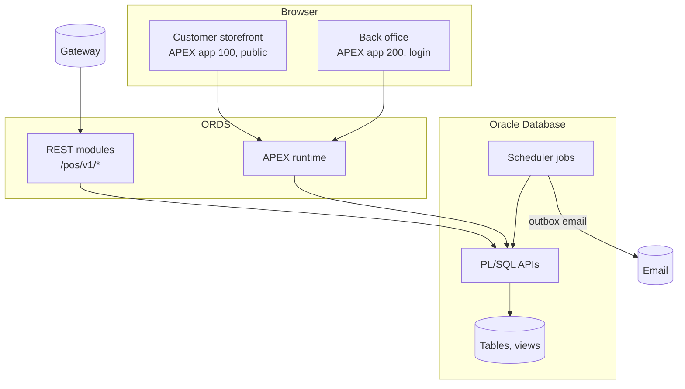
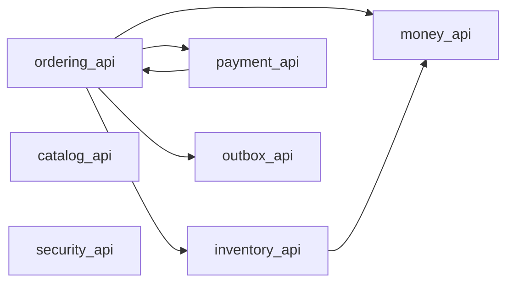

# Architecture: CornerMart POS

- Version: 0.1
- Date: 2026-11-18
- Template: arc42 (condensed)
- Refs: Vision, SRS NFRs, Domain #2-3, Data #8

## 1. Introduction and goals
- Quality goals (priority order):
	1. Consistency (zero oversell, NFR-01)
	2. Auditability (NFR-05)
	3. Responsiveness (NFR-02/03)
- Stakeholders: Owner (Admin), Cashier, Stock manager, Customer, Developer (1).

## 2. Constraints
- Oracle APEX + Oracle DB (ADR-0002); Oracle Cloud free tier / APEX service.
- 1 developer, 1 week.
- No card data on our servers (Financial #9)
- Pakistan: tax/receipt rules TBD.

## 3. Context and scope (C4 L1)
```mermaid
flowChart TB
	Cust([Customer]) -->|browse, order, track| POS[CornerMart POS<br/>APEX + Oracle DB]
	Staff([Cashier / Stock manager / Admin]) -->|sell, receive, count, pack| POS
	POS -->|payment redirect| GW[(Payment gateway)]
	GW -->|webhook| POS
	POS -->|email| SMTP[(Email service)]
	Owner([Admin]) -.->|reports| POS
```

External: payment gateway (TBD), email service. No other integrations (NG3).

## 4. Solution strategy
| Goal | Approach |
| ---- | -------- |
| Zero oversell | Pessimistic row lock, reservation ledger, single transaction |
| Auditibility | Insert-only ledger/history, API-only DML |
| Responsiveness | Indexed queries, APEX polling 5 s, small payloads |
| 1 dev, fast | Thick DB (PL/SQL packages), APEX declarative UI |
| Security/PCI | Hosted payment redirect, tokens only |

## 5. Building blocks
C4 L2 containers:


C4 L3 (inside DB):


| Component | Responsibility | Context |
| --------- | -------------- | ------- |
| catalog_api | Product CRUD, price | Catalog |
| inventory_api | Ledger, reserve/release/consume, counts | Inventory |
| ordering_api | `transition`, place, history | Ordering |
| payment_api | Payments, refunds, webhook handling | Paymetn |
| money_api | Refunding, tax, totals | Shared |
| outbox_api | Enqueue/process events | Shared |
| security_api | Role checks used by authorization schemes | Identity |

Rules:
- UI and REST call APIs only; no table DML from APEX pages.
- Cross-context calls via package API only, per Domain #3.
- Dependency direction: no cycles except payment <-> ordering callback.

## 6. Runtime view
- Place order, expiry, handover: Order spec #3.
- Payment webhook: ORDS -> `payment_api.hanlde_webhook` -> verify signature -> dedupe -> `ordering_api.transition(pay)`.

## 7. Deployment view
| Env | Purpose | Notes |
| --- | ------- | ----- |
| dev | Build | Developer workspace, seed data |
| test | UAT, concurrency tests | Copy of prod schema via Liquibase |
| prod | Live | Backups, RPO 15 min / RTO 4 h |

- Schemas: `POS_DATA` (tables, packages), `POS_APP` (APEX parsing schema, EXECUTE only), `POS_REST` (ORDS-enabled).
- Deploy: Liquibase changelog + APEX export import, via SQLcl in CI.

## 8. Cross-cutting concepts
- Transactions: one API call = one transaction; COMMIT only at API boundary (UI/REST layer), never inside lower APIs.
- Errors: `RAISE_APPLICATION_ERROR(-20xx, code)` mapped to catalog (Order #9); API translates to HTTP 4xx/409/422.
- Logging: `app_log` table (level, module, message, context JSON); no PII/card fields.
- Security: APEX authentication (users: APEX accounts/SSO later); authorization schemes per role; storefront public pages rate-limited; see 09-security.
- Config: `app_config` table (expiry minutes, discount limits); secrets in APEX Web Credentials.
- Time: DB stores UTC; UI shows Asia/Karachi.
- i18n: English v1.

## 9. API contract (ORDS, OpenAPI 3.1)
| Method | Path | Purpose | Auth | Idempotent |
| ------ | ---- | ------- | ---- | ---------- |
| GET | /pos/v1/products | List available products | Public | Yes |
| POST | /pos/v1/orders | Place order (header `Idempotency-Key`) | Customer/guest | Yes |
| GET | /pos/v1/orders/{order_no}?email= | Tracking | Public + email | Yes (state) |
| POST | /pos/v1/payments/webhook | Gateway callback | Signature | Yes (event id) |

Errors: JSON `{code, message}`; 409 conflict (insufficient stock), 422 validations. Staff operations stay in APEX, not REST (v1).
Spec stored `/docs/api/openapi.yaml`.

## 10. Architecture decisions
ADR-0002..0015 (see /docs/adr).

## 11. Quality scenarios
SRS #5 NFR-01..08; each mapped to a test in 11-test-strategy.

## 12. Risks and technical debt
| Risk | Mitigation |
| ---- | ---------- |
| Single DB = single point of failure | Backups, RPO/RTO plan |
| Hot-row lock contention on popular SKU | Short transactions, load test |
| Payment gateway unknown | Abstract `payment_api`, pay-at-pickup fallback |
| PL/SQL skill dependency | Package standards, utPLSQL tests |
| APEX session/polling load | Cache, 5 s interval, review at 10x volume |

 ## 13. Open questions
- ORDS + APEX hosting: Autonomous DB (managed) vs self-hosted?
- Customer accounts vs guest checkout?
- Staff SSO needed?